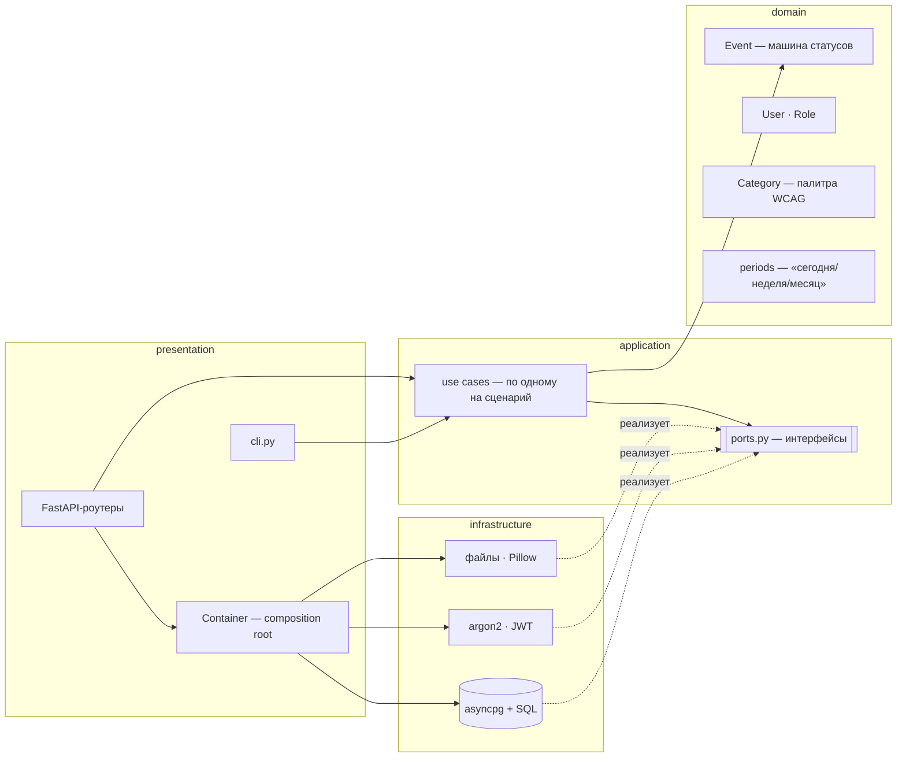
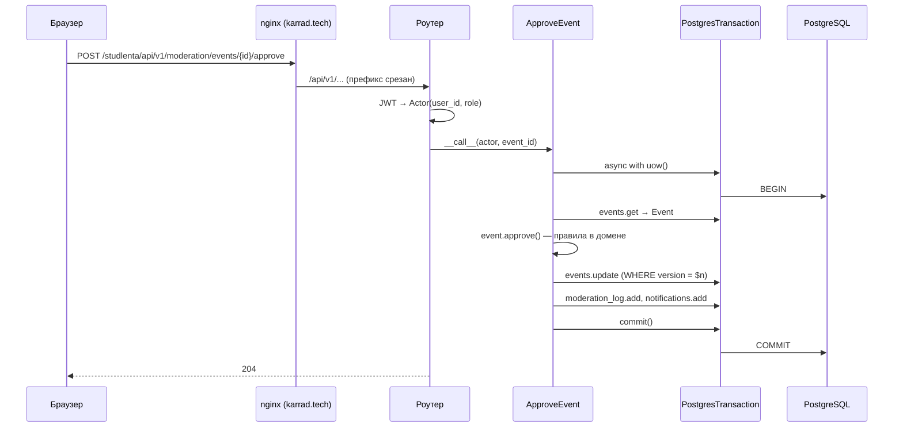
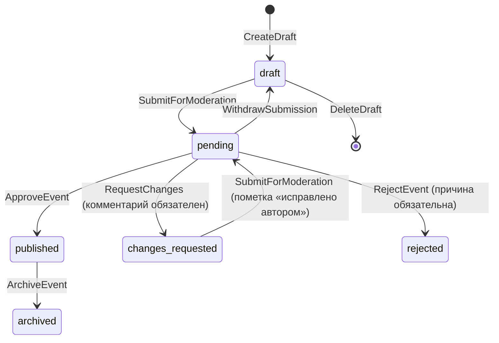
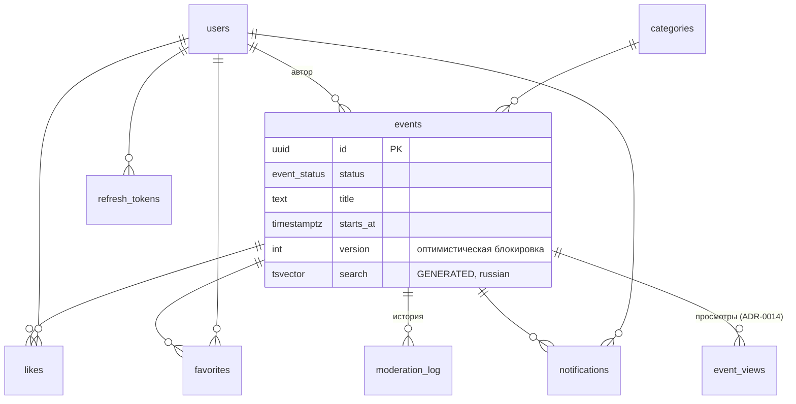
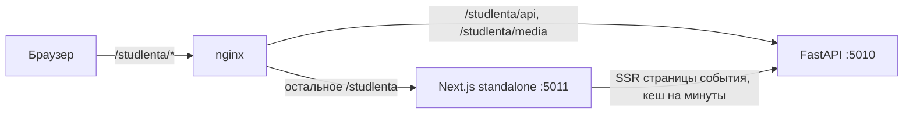

# Архитектура

## Слои (onion)

Зависимости направлены **внутрь**: домен ничего не знает о базе и HTTP, use case'ы —
только о домене и портах. Это проверяет `import-linter` (контракты в `backend/pyproject.toml`).

Что это даёт на практике:

- правила предметной области и сценарии тестируются без базы — 140+ юнит-тестов за ~1 с;
- SQL можно переписывать, не трогая сценарии, — защищают интеграционные тесты;
- роутеры тонкие: разобрать запрос → вызвать use case → вернуть ответ.

## Путь запроса

Ошибки домена (`ValidationError`, `InvalidTransitionError`, `ConflictError`…) поднимаются
наверх как есть; `presentation/api/errors.py` превращает их в HTTP-коды и единый формат
`{"error": {"code", "message", "fields"}}`.

## Жизненный цикл события

- Переходы проверяет `domain/events.py`; база дублирует ключевые инварианты через CHECK.
- Публично видно только `published`.
- Модератор не может модерировать своё событие (принцип «четырёх глаз»).
- Гонка двух модераторов ловится оптимистической блокировкой (`version`) → HTTP 409.

## Данные

Схема — `backend/src/studlenta/infrastructure/db/migrations/`. Ключевые индексы:

| Индекс | Для чего |
|--------|----------|
| `events_feed_idx (starts_at, id) WHERE status='published'` | лента и keyset-пагинация |
| `events_search_idx GIN (search)` | поиск с русской морфологией («концерты» находит «концерт») |
| `events_queue_idx (status, submitted_at, id)` | очередь модерации |
| `notifications_one_reminder UNIQUE … WHERE kind='reminder'` | напоминание приходит один раз |
| `event_views PK (event_id, viewer, viewed_on)` | один просмотр на зрителя в день; `(viewer, viewed_at)` — история для «Для вас» |

## Чтение и запись

Запись идёт через доменные сущности (`EventRepository` → `Event` → методы-переходы).
Чтение для экранов — отдельные SQL-запросы, сразу собирающие DTO (`EventQueries`):
лента с числом лайков и флагами «лайкнул / в избранном» — **один** запрос, без N+1.

## Время

Все даты в базе — `timestamptz` (UTC). «Сегодня», «на этой неделе» и дни календаря
считаются в часовом поясе университета (`Asia/Yekaterinburg`, настройка `STUDLENTA_TIMEZONE`):
событие в 00:30 по Уфе относится к своему дню, хотя в UTC это ещё вчера.

## Безопасность

- Пароли — argon2id. Вход: одинаковый ответ для «нет такой почты» и «неверный пароль»,
  лимит 10 неудачных попыток в минуту (429).
- Access JWT живёт 15 минут и хранится в памяти фронтенда. Refresh — случайный токен в
  httpOnly + Secure + SameSite=Strict cookie, в базе только SHA-256, ротация при каждом
  обновлении, отзыв при выходе.
- Обложки: проверка содержимого через Pillow (не по расширению), ≤ 5 МБ, ширина ≥ 1200 px,
  имя файла генерирует сервер, `cover_url` принимается только со своего `/media/covers/`.
- SQL — только параметры `$n`; склеиваются лишь константы модуля.

## Фронтенд

- **Страница события** рендерится на сервере (`app/events/[id]`): `'use cache'` + `cacheLife('minutes')`,
  `generateMetadata` даёт og:title / og:image для превью в ВК и Telegram. Флаги текущего
  пользователя дозапрашивает клиент.
- **Остальные экраны** — клиентские компоненты на TanStack Query; фильтры ленты живут в URL.
- **Слои клиента**: `lib/api` (типизированный клиент: токен в памяти, один refresh на пачку 401),
  `lib/auth` (сессия, перенос гостевого избранного после входа), `lib/queries` (запросы и
  оптимистичные реакции с откатом), `components` (UI без знания о транспорте), `app` (страницы).
- **Скины** — CSS-переменные на `<html data-skin>`; инлайн-скрипт в `<head>` ставит скин до отрисовки.
- **Доступность** проверяется дважды: unit-тест контраста по токенам всех скинов и axe в e2e.

Решение и альтернативы — [ADR-0011](adr/0011-frontend-nextjs.md).
