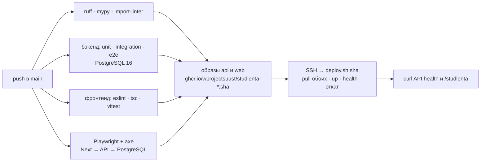

# Деплой

Прод: **https://karrad.tech/studlenta** (API: `/studlenta/api/v1`, Swagger: `/studlenta/api/v1/docs`).
Решение и альтернативы — [ADR-0010](adr/0010-deploy-ghcr-and-ssh-forced-command.md).

## Пайплайн



PR проходит те же проверки и тесты плюс формат коммитов, но не собирает образ и не деплоит.

## Сервер

```
/opt/studlenta/
  docker-compose.yml   ← deploy/docker-compose.prod.yml
  deploy.sh            ← deploy/deploy.sh
  .env                 секреты (создаются на сервере, в git их нет) + RELEASE_TAG текущего релиза
  .docker/             отдельный docker-конфиг для входа в GHCR на время деплоя
```

- API слушает `127.0.0.1:5010`, веб — `127.0.0.1:5011`; наружу только через nginx:
  `/etc/nginx/snippets/studlenta.conf` (+ `studlenta-proxy.conf`) подключён одной строкой
  `include` в сайт karrad.tech. Копии — `deploy/nginx-studlenta*.conf`; nginx правит
  администратор вручную (ключ CI этого не может — так задумано).
- Лимиты памяти: API 256 МБ, веб 192 МБ, Postgres 192 МБ — на сервере работает соседний прод.
- API и веб выкатываются одним тегом (`RELEASE_TAG` = git sha); если хоть один не стал
  healthy — откатываются оба.
- Миграции применяются при старте контейнера (идемпотентно, под advisory lock).

## Секреты GitHub (environment `production`)

| Секрет | Что |
|--------|-----|
| `DEPLOY_SSH_KEY` | приватный ключ `studlenta-ci-deploy`; на сервере ограничен `command="/opt/studlenta/deploy.sh",restrict` |
| `DEPLOY_KNOWN_HOSTS` | отпечаток хоста сервера |
| `DEPLOY_HOST`, `DEPLOY_USER` | адрес и пользователь |

Токен для скачивания образа — `GITHUB_TOKEN` джобы, живёт только во время деплоя.

## Почта

Письма подтверждения уходят с `studlenta@karrad.tech` через postfix этого же сервера
(submission 587, STARTTLS, DKIM подписывает opendkim) — [ADR-0012](adr/0012-email-verification.md).
Пароль ящика — `SMTP_PASSWORD` в `/opt/studlenta/.env`. Проверить отправку:
`journalctl -u postfix@- --since "10 min ago" | grep studlenta`.

## Демо-данные

В проде лежат 8 вымышленных событий от демо-организаторов (`org-*@karrad.tech`, роль author,
подтверждены CLI). Фото — Wikimedia Commons под CC BY / BY-SA, автор и лицензия указаны в
конце описания каждого события. Убрать демо: снять события с публикации из кабинета админа.

## Частые операции

Команды выполняются администратором со своим ключом, а не ключом CI.

```bash
# создать модератора
ssh karrad 'cd /opt/studlenta && docker compose exec -e STUDLENTA_NEW_PASSWORD=... api \
  uv run --no-sync studlenta-create-user --email mod@uust.ru --name "Имя Фамилия" --role moderator'

# логи
ssh karrad 'cd /opt/studlenta && docker compose logs --tail 100 api'

# откат вручную на прошлую версию: перезапустить нужный workflow run в Actions
# или на сервере: sed -i 's/^RELEASE_TAG=.*/RELEASE_TAG=<sha>/' .env && docker compose up -d

# обложки, загруженные до появления превью (идемпотентно)
ssh karrad 'cd /opt/studlenta && docker compose exec -T api uv run --no-sync studlenta-rebuild-covers'

# бэкап базы
ssh karrad 'cd /opt/studlenta && docker compose exec -T db pg_dump -U studlenta studlenta' > backup.sql
```

## Расписание (cron)

`/etc/cron.d/studlenta` на сервере (копия — `deploy/cron.studlenta`):

- каждый час — напоминания о событиях из избранного (`studlenta-send-reminders`);
- раз в сутки — удаление неиспользуемых обложек (`studlenta-cleanup-media`).

Вывод пишется в `/var/log/studlenta-cron.log`.
