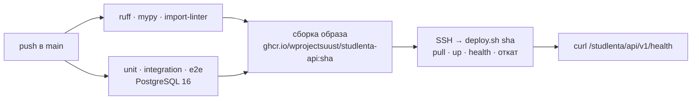

# Деплой

Прод: **https://karrad.tech/studlenta/** (API: `/studlenta/api/v1`, Swagger: `/studlenta/api/v1/docs`).
Решение и альтернативы — [ADR-0010](adr/0010-deploy-ghcr-and-ssh-forced-command.md).

## Пайплайн



PR проходит те же проверки и тесты плюс формат коммитов, но не собирает образ и не деплоит.

## Сервер

```
/opt/studlenta/
  docker-compose.yml   ← deploy/docker-compose.prod.yml
  deploy.sh            ← deploy/deploy.sh
  .env                 секреты (создаются на сервере, в git их нет) + API_TAG текущей версии
  .docker/             отдельный docker-конфиг для входа в GHCR на время деплоя
```

- API слушает `127.0.0.1:5010`, наружу только через nginx (`deploy/nginx-studlenta.conf`
  внутри сайта karrad.tech).
- Лимиты памяти: API 256 МБ, Postgres 192 МБ — на сервере работает соседний прод.
- Миграции применяются при старте контейнера (идемпотентно, под advisory lock).

## Секреты GitHub (environment `production`)

| Секрет | Что |
|--------|-----|
| `DEPLOY_SSH_KEY` | приватный ключ `studlenta-ci-deploy`; на сервере ограничен `command="/opt/studlenta/deploy.sh",restrict` |
| `DEPLOY_KNOWN_HOSTS` | отпечаток хоста сервера |
| `DEPLOY_HOST`, `DEPLOY_USER` | адрес и пользователь |

Токен для скачивания образа — `GITHUB_TOKEN` джобы, живёт только во время деплоя.

## Частые операции

Команды выполняются администратором со своим ключом, а не ключом CI.

```bash
# создать модератора
ssh karrad 'cd /opt/studlenta && docker compose exec -e STUDLENTA_NEW_PASSWORD=... api \
  uv run --no-sync studlenta-create-user --email mod@uust.ru --name "Имя Фамилия" --role moderator'

# логи
ssh karrad 'cd /opt/studlenta && docker compose logs --tail 100 api'

# откат вручную на прошлую версию: перезапустить нужный workflow run в Actions
# или на сервере: sed -i 's/^API_TAG=.*/API_TAG=<sha>/' .env && docker compose up -d

# бэкап базы
ssh karrad 'cd /opt/studlenta && docker compose exec -T db pg_dump -U studlenta studlenta' > backup.sql
```

## Напоминания об избранном

Раз в час (cron на сервере):

```
0 * * * * cd /opt/studlenta && docker compose exec -T api uv run --no-sync studlenta-send-reminders
```
